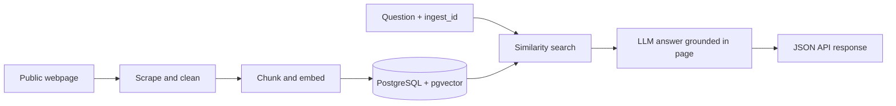

<div align="center">

# PulseAI | Website Research API

**Turn public webpages into searchable, question-answerable research.**


</div>

> **Research the page, not the model's memory.**
>
> PulseAI helps InsightIQ analysts turn public webpages into reusable,
> searchable research. Ingest a page once, ask questions with its `ingest_id`,
> and get concise answers grounded in the page's own content—not general
> model knowledge. If the page does not contain the answer, PulseAI returns:
> **“This information was not found on the website.”**

<div align="center">

**INGEST A WEBPAGE** &nbsp;→&nbsp; **FIND RELEVANT PASSAGES** &nbsp;→&nbsp;
**GET A GROUNDED ANSWER**

</div>

PulseAI processes one submitted webpage at a time; it does not crawl every
page across a domain.

## How it works



## Tech stack

| Layer | Technology |
| --- | --- |
| API | Python 3.14, FastAPI, Uvicorn |
| Web extraction | Playwright, Beautiful Soup |
| Retrieval | OpenAI embeddings, PostgreSQL, pgvector |
| Answer generation | OpenAI Responses API |
| Validation and configuration | Pydantic, `.env` |
| Tests | Pytest, pytest-asyncio |

## Run locally (Windows)

Prerequisites: Python 3.14, Docker Desktop with Docker Compose, and an OpenAI
API key with access to the configured models. OpenAI API usage may incur
charges.

Run these PowerShell commands from the repository root:

```powershell
Set-Location .\pulseAI_App
py -3.14 -m venv .venv
.\.venv\Scripts\Activate.ps1
python -m pip install --upgrade pip
python -m pip install -r requirements.txt
python -m playwright install chromium
Copy-Item .env.example .env
```

Edit `pulseAI_App\.env`: set your OpenAI API key, an enabled chat model, and
your database password. Keep the password in `DB_PASSWORD` and
`DATABASE_URL` consistent. **Never commit `.env` or share its credentials.**

### Initialize PostgreSQL and pgvector

Start the PostgreSQL container that includes pgvector:

```powershell
docker compose up -d
docker compose ps
```

Wait until PostgreSQL reports healthy, then initialize the vector extension
and application tables:

```powershell
python -m app.models.init_db
```

This command enables the PostgreSQL `vector` extension and creates the
website and content-chunk tables, including the vector column used for
semantic search.

### Start the API

```powershell
python -m uvicorn app.main:app --reload
```

Open **http://127.0.0.1:8000/docs** to explore and call the API.

## API

1. `POST /api/v1/ingest` with `{"url": "https://example.com/"}`.
2. Save the `data.ingest_id` from the response.
3. `POST /api/v1/ask` with that ID and a question:

```json
{
  "ingest_id": "your-ingest-uuid",
  "question": "What does this website describe?"
}
```

The API returns the existing ID for a previously ingested normalized URL.
Answers use retrieved webpage excerpts as context; when no relevant content
is available, the response is `This information was not found on the website`.
Success and error responses use a consistent JSON envelope.

## Tests

From `pulseAI_App` with the virtual environment active:

```powershell
python -m pytest -v
```
